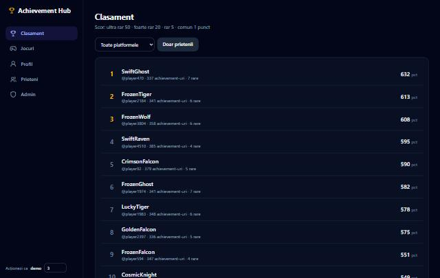
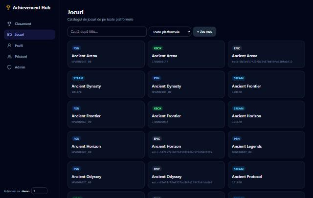
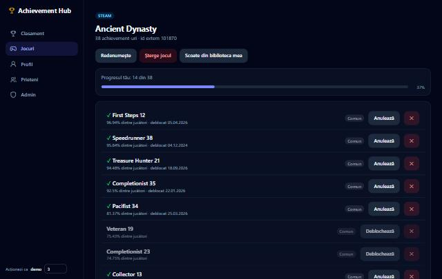
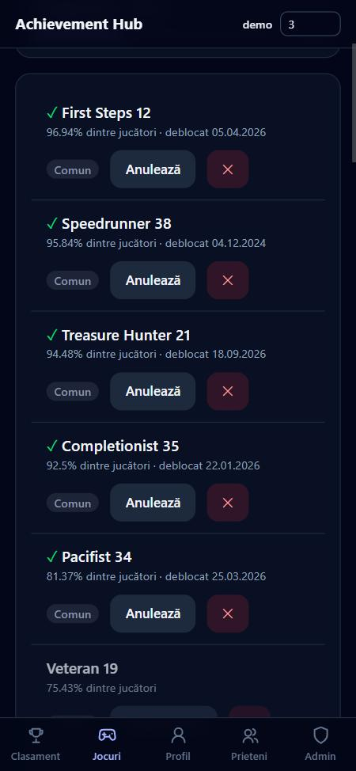
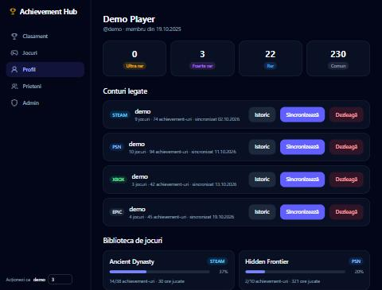
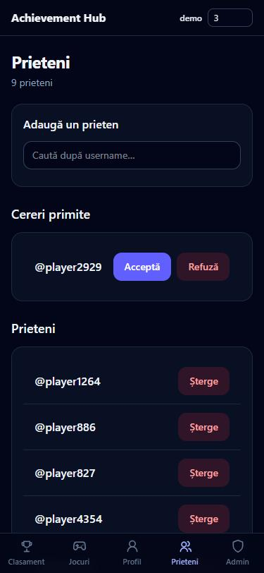
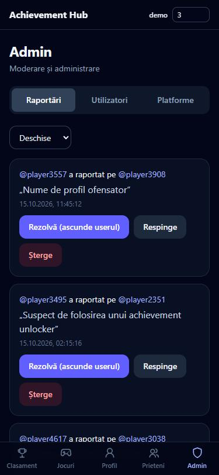

# Paginile aplicației

Aplicația are 5 secțiuni în meniu și 2 pagini de detaliu. Pe telefon meniul e o bară de tab-uri jos,
iar pe ecrane late (de la 768px) e un sidebar în stânga. Fiecare pagină citește datele prin API (`/api/...`),
iar după orice modificare lista afectată se reîncarcă automat.

> Toate paginile cer autentificare (altfel → `/login`). Coloana **Roluri** arată ce poate face fiecare rol;
> API-ul verifică aceleași reguli la fiecare cerere (vezi [api.md](api.md#roluri)).
> Interfața e în stil „Liquid Glass” (D42): carduri și bare de sticlă translucide peste un fundal colorat animat.

| Pagină | Adresă | Roluri | Entități (tabele) | Operații |
|---|---|---|---|---|
| [Login](#0-login) | `/login`, `/auth/callback` | public | users, refresh_tokens | înregistrare, login (email sau Steam) |
| [Clasament](#1-clasament) | `/` | toți | users, platform_accounts, user_achievements, achievements, friendships | citire (agregare) |
| [Jocuri](#2-jocuri) | `/games` | toți; adăugare: admin | games, platforms | listă, căutare, creare |
| [Detaliu joc](#3-detaliu-joc) | `/games/:id` | toți; editare catalog: admin | games, achievements, user_games, user_achievements | citire, modificare, ștergere joc; CRUD achievement-uri; adăugare/scoatere din bibliotecă; deblocare |
| [Profil](#4-profil) | `/users/:id` | toți; conturi, sync, rapoarte CSV/Excel: proprietarul (și adminul) | users, platform_accounts, user_games, sync_runs, friendships, reports | citire; legare/dezlegare cont; pornire sync; cerere de prietenie; raportare |
| [Prieteni](#5-prieteni) | `/friends` | user logat | friendships, users | listă, trimitere, acceptare, refuz, ștergere |
| [Admin](#6-admin) | `/admin` | moderator: raportări, suspendare / ascundere, raport PDF; admin: și roluri, ștergere, platforme | reports, users, platforms | CRUD complet |

---

## 0. Login

**Scop:** intrarea în aplicație. Control segmentat „Autentificare / Cont nou”, câmpuri email + parolă
(+ username la înregistrare) și butonul **Continuă cu Steam**.
- Înregistrarea creează un user cu rolul `user` (parola → hash argon2) și pornește direct sesiunea;
- erorile din DB apar sub formular (ex. username luat → `users_username_lower_uq`);
- `/auth/callback` primește tokenurile după login-ul Steam și le salvează.

**API:** `POST /api/auth/register`, `POST /api/auth/login`, `GET /api/auth/steam`, `GET /api/auth/me`.

---

## 1. Clasament

**Scop:** cine are cele mai valoroase achievement-uri. Scorul ține cont de raritate: ultra rar 50 de puncte,
foarte rar 20, rar 5, comun 1. Un singur achievement ultra rar contează cât 50 de achievement-uri comune.

**Ce afișează:** poziția (`rank()` calculat în SQL), numele, numărul de achievement-uri, câte sunt rare, scorul.
Userul curent e evidențiat. Primii trei au poziția aurie.

**Acțiuni:**
- filtru pe platformă (doar achievement-urile de pe Steam, PSN etc.);
- „Doar prietenii”: clasamentul restrâns la userul curent și prietenii lui acceptați;
- paginare (20 pe pagină); click pe un nume deschide profilul.

**Reguli:** userii ascunși de un moderator și cei banați nu apar.

**API:** `GET /api/leaderboard?platform_id=&friends_of=&limit=&offset=`. Este cea mai grea interogare
(agregare peste ~650.000 de rânduri, ~3 s pe Supabase) și va fi optimizată în etapa 4.

---

## 2. Jocuri

**Scop:** catalogul tuturor jocurilor, de pe toate platformele.

**Ce afișează:** carduri cu platforma, titlul și id-ul extern al jocului (appid la Steam, NPWR… la PSN).

**Acțiuni:**
- căutare după titlu (oriunde în titlu, fără să conteze literele mari/mici);
- filtru pe platformă; paginare (24 pe pagină);
- **+ Joc nou** (Create): platformă, id extern, titlu. Același id extern pe aceeași platformă e respins de baza de date
  (`games_external_uq`), iar eroarea apare în formular.

**API:** `GET /api/games`, `POST /api/games`, `GET /api/platforms`.

---

## 3. Detaliu joc

**Scop:** achievement-urile unui joc, cât de rare sunt și ce a deblocat userul curent.

**Ce afișează:** titlul, numărul de achievement-uri, progresul userului (bară cu procent), apoi fiecare achievement
cu procentul global, eticheta de raritate și data deblocării (✓). Ordonate de la cel mai comun la cel mai rar.

**Acțiuni:**
- **Redenumește** / **Șterge jocul** (Update / Delete pe `games`); ștergerea elimină în cascadă achievement-urile
  și progresul tuturor userilor pe acel joc;
- **Adaugă în biblioteca mea** / **Scoate din biblioteca mea** (Create / Delete pe `user_games`), doar dacă userul are
  cont pe platforma jocului;
- **Deblochează** / **Anulează** (Create / Delete pe `user_achievements`), doar pentru jocurile din bibliotecă;
- **Adaugă achievement** (Create) și **✕** (Delete) pe `achievements`. Un procent în afara intervalului 0–100 e respins
  de CHECK-ul `achievements_pct_chk`; raritatea se calculează automat din procent (coloană generată).

**API:** `GET /api/games/:id`, `GET /api/games/:id/achievements?user_id=`, `PATCH`/`DELETE /api/games/:id`,
`POST`/`DELETE /api/achievements`, `POST`/`DELETE /api/user-games`, `POST`/`DELETE /api/user-achievements`.

Pe telefon, butoanele fiecărui achievement trec sub text:

---

## 4. Profil

**Scop:** profilul unificat: tot ce are un jucător, de pe toate platformele, într-un singur loc.

**Ce afișează:**
- capul profilului: **banner** și **culoare de accent** alese de user, avatar, nume, rol, data înscrierii, **bio**,
  totaluri (jocuri, achievement-uri, ore jucate, jocuri terminate 100%) și **jocul preferat**;
- **Vitrina**: până la 3 achievement-uri alese de user (`profile_showcase`);
- **Deblocate recent**: ultimele 6 achievement-uri; avertisment dacă userul e ascuns din clasamente;
- patru carduri cu numărul de achievement-uri pe fiecare raritate;
- **Conturi legate**: platforma, numele, câte jocuri și achievement-uri are contul, data ultimei sincronizări;
- **Biblioteca de jocuri**: toate jocurile de pe toate conturile, cu progresul (deblocate / total) și orele jucate,
  încărcate câte 12 („Mai multe jocuri”).

**Acțiuni pe profilul propriu:**
- **Editează profilul** (Update pe `users` + înlocuirea vitrinei în `profile_showcase`, într-o tranzacție):
  nume afișat, avatar (link https), bio, accent, banner, joc preferat (din bibliotecă), vitrina (din achievement-urile deblocate);
- **Conectează Steam** (Create pe `platform_accounts` prin login Steam, D47): SteamID-ul vine confirmat de Steam,
  deci nimeni nu poate lega contul altcuiva; prima sincronizare pornește automat. PSN / Xbox / Epic apar „În curând”
  (n-au integrare reală; cu `ALLOW_MOCK_PLATFORMS=true` se pot lega cu date demo);
- **Dezleagă** (Delete): progresul contului dispare prin ON DELETE CASCADE;
- **Sincronizează** (Create pe `sync_runs`, status `queued`) și **Istoric** (ultimele 5 sincronizări). Execuția
  e făcută de worker (pg-boss); pagina arată live „în coadă / se sincronizează” și motivul unui eșec.

**Acțiuni pe profilul altcuiva:**
- **Trimite cerere de prietenie** (Create pe `friendships`);
- **Raportează** cu un motiv (Create pe `reports`); motivul trebuie să aibă 5–1000 de caractere (CHECK).

**API:** `GET /api/users/:id/profile`, `GET /api/users/:id/games`, `POST`/`DELETE /api/platform-accounts`,
`POST`/`GET /api/sync-runs`, `POST /api/friendships`, `POST /api/reports`.

---

## 5. Prieteni

**Scop:** relațiile userului curent cu alți jucători.

**Ce afișează:** numărul de prieteni, apoi trei liste: **Cereri primite**, **Cereri trimise**, **Prieteni**.

**Acțiuni:**
- **Adaugă un prieten**: căutare după username, apoi **Trimite cerere** (Create). O cerere inversă față de una existentă
  e respinsă de indexul unic `friendships_pair_uq`;
- **Acceptă** (Update: `status = accepted`, se completează `responded_at`), **Refuză** / **Anulează** / **Șterge** (Delete).

**API:** `GET /api/friendships?user_id=`, `GET /api/users?search=`, `POST`/`PATCH`/`DELETE /api/friendships`.

---

## 6. Admin

**Scop:** moderare și administrare, în trei tab-uri.

**Raportări** (moderator, admin): lista raportărilor filtrată după status (deschise / rezolvate / respinse).
- **Rezolvă**: raportarea devine `resolved`, iar userul raportat e ascuns din clasamente, ambele în aceeași tranzacție;
- **Respinge** (`rejected`), **Șterge**.

**Utilizatori** (admin): căutare, creare (username, email, parolă salvată ca hash argon2, rol), schimbarea rolului
din listă, **Banează** / **Debanează**, **Ascunde din clasament**, **Șterge** (cu toate datele userului, în cascadă).

**Platforme** (admin): redenumire (la ieșirea din câmp), comutare Mock/Real, adăugare, ștergere. O platformă care are
conturi sau jocuri nu poate fi ștearsă (ON DELETE RESTRICT), iar pagina afișează eroarea venită din baza de date.

**API:** `GET`/`PATCH`/`DELETE /api/reports`, `GET`/`POST`/`PATCH`/`DELETE /api/users`, `GET`/`POST`/`PATCH`/`DELETE /api/platforms`.

---

## Cum apar erorile din baza de date

Formularele nu dublează regulile bazei de date. Când o operație încalcă o constrângere, API-ul întoarce mesajul
și numele constrângerii, iar pagina le afișează sub formular, de exemplu:

> Există deja o înregistrare cu aceste valori unice `(platform_accounts_user_platform_uq)`
