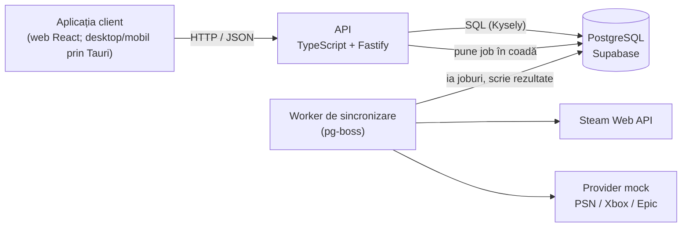

# Achievement Hub — documentul de prezentare

Proiect individual, Baze de date avansate. Documentul se completează la fiecare etapă de verificare.

| Etapa | Conținut | Stare |
|---|---|---|
| 0. Tema | domeniul temei | ✅ |
| 1. Modelare | tabele, relații, constrângeri, fixtures | ✅ |
| 2. CRUD | operații CRUD, descrierea paginilor | ✅ |
| 3. Autentificare | autentificare, 3 roluri | ⏳ |
| 4. Performanță | indecși, load test | ⏳ |
| 5. Rapoarte | PDF, CSV, Excel | ⏳ |

---

## 0. Tema — domeniul aplicației

### Problema
Un jucător are de obicei conturi pe mai multe platforme: Steam, PlayStation, Xbox, Epic Games. Fiecare platformă își ține
separat jocurile și achievement-urile (trofeele), deci nu există un loc în care jucătorul să-și vadă tot progresul, să afle
cât de rare sunt achievement-urile obținute sau să se compare cu prietenii indiferent de platformă.

### Soluția
**Achievement Hub** este o aplicație în care utilizatorul:
1. își face un cont (email + parolă sau direct cu contul Steam);
2. își leagă conturile de pe platforme;
3. aplicația **sincronizează** jocurile și achievement-urile de pe fiecare platformă;
4. utilizatorul vede un **profil unificat**: toate jocurile, progresul pe fiecare joc, achievement-urile rare,
   poziția în **clasamente** și comparația cu **prietenii**.

### Actori și roluri

| Actor | Ce poate face |
|---|---|
| Vizitator (nelogat) | își face cont, se loghează, vede clasamentul public |
| **user** | își gestionează profilul, își leagă/dezleagă conturile de platformă, pornește sincronizarea, își vede progresul, trimite/acceptă cereri de prietenie, raportează profiluri suspecte |
| **moderator** | tot ce poate un user + rezolvă raportările, ascunde din clasamente utilizatorii care trișează, corectează catalogul de jocuri și achievement-uri |
| **admin** | tot ce poate un moderator + gestionează utilizatorii și rolurile lor, platformele, generează rapoartele globale |

### Conceptele domeniului

| Concept | Explicație |
|---|---|
| Platformă | Steam, PlayStation Network, Xbox, Epic Games. Steam are integrare reală (Steam Web API); celelalte nu au API public stabil, deci datele lor sunt simulate realist printr-un provider mock |
| Cont de platformă | contul unui utilizator pe o platformă, identificat de id-ul extern (ex. SteamID64) |
| Joc | un titlu din catalogul unei platforme; același joc pe două platforme are achievement-uri diferite, deci e tratat separat |
| Achievement | o realizare dintr-un joc (ex. „termină jocul pe dificultate maximă”) |
| Raritate | procentul jucătorilor de pe platformă care au deblocat achievement-ul: sub 1% ultra rar, sub 5% foarte rar, sub 20% rar, restul comun |
| Progres | câte achievement-uri dintr-un joc a deblocat utilizatorul, din totalul jocului |
| Sincronizare | citirea datelor de pe platformă și actualizarea bazei; rulează în fundal (job), iar rezultatul fiecărei rulări e păstrat în istoric |
| Clasament | ordonarea utilizatorilor după achievement-uri (număr sau scor ponderat cu raritatea), global sau doar între prieteni |
| Prietenie | o cerere trimisă de un utilizator altuia, care devine prietenie când e acceptată |
| Raportare | semnalarea unui profil suspect (ex. achievement-uri deblocate imposibil de repede), rezolvată de un moderator |

### Reguli de business
- Un utilizator poate lega **cel mult un cont** pe fiecare platformă, iar un cont de platformă poate fi legat de **un singur utilizator**.
- Un achievement poate fi deblocat **o singură dată** de același cont.
- Dacă utilizatorul își dezleagă un cont, **tot progresul** acelui cont dispare din profil.
- Prietenia nu e direcțională: dacă A și B sunt prieteni, B nu mai poate trimite o cerere către A; nimeni nu poate fi propriul prieten.
- Utilizatorii ascunși de un moderator **nu apar în clasamente**.
- Tokenurile de acces la platforme sunt păstrate **criptat**; parolele utilizatorilor sunt păstrate doar ca **hash**.

### Arhitectura pe scurt

Baza de date este centrul aplicației: datele, sesiunile, coada de joburi și istoricul sincronizărilor sunt toate în PostgreSQL.

---

## 1. Modelare

- **11 tabele** cu chei primare, chei străine, UNIQUE, CHECK și NOT NULL: [schema și diagrama ER](schema.md).
- Constrângerile importante și motivul fiecăreia: [DECISIONS.md](../DECISIONS.md), deciziile D2–D12.
- Migrații SQL numerotate în `db/migrations/`, aplicate automat la pornire.
- **Fixtures** generate automat la pornire, direct în SQL: ~5.000 utilizatori, ~10.000 conturi de platformă,
  ~65.000 jocuri deținute, ~650.000 achievement-uri deblocate. Detalii: [fixtures](fixtures.md).

---

## 2. CRUD

### Operații CRUD (API)
- CRUD complet pentru toate cele 10 entități de domeniu: [lista rutelor](api.md). Sesiunile (`refresh_tokens`)
  sunt gestionate de autentificare (etapa 3).
- Constrângerile sunt verificate **de baza de date**, nu duplicate în cod; API-ul traduce codul de eroare Postgres
  (SQLSTATE) în răspuns HTTP: `UNIQUE` → 409, `CHECK` → 400, `ON DELETE RESTRICT` → 409, cu numele constrângerii.
- Entitățile cu cheie primară compusă (jocuri deținute, achievement-uri deblocate, prietenii) au rute cu doi parametri.
- Operația care modifică două tabele (rezolvarea unei raportări + ascunderea utilizatorului) rulează într-o tranzacție.
- 8 teste de integrare (`npm test`) rulează pe un Postgres în memorie cu migrațiile reale.

### Paginile aplicației
Aplicația React (mobile-first: tab-uri jos pe telefon, sidebar pe desktop) are 6 pagini, toate legate la API.
Descrierea completă, cu capturi de ecran, rolurile, tabelele și operațiile fiecărei pagini: [paginile aplicației](pagini.md).

| Pagină | Ce face | CRUD |
|---|---|---|
| Clasament | top jucători după scor ponderat cu raritatea; global, pe platformă, între prieteni | R |
| Jocuri | catalogul de jocuri, căutare, filtru pe platformă | C R |
| Detaliu joc | achievement-uri cu raritate, progresul userului, deblocare, editare catalog | C R U D |
| Profil | profil unificat: raritate, conturi legate, biblioteca cu progres, sync, prietenie, raportare | C R D |
| Prieteni | cereri primite / trimise, prieteni, adăugare după username | C R U D |
| Admin | raportări (rezolvare = tranzacție), utilizatori, platforme | C R U D |

## 3. Autentificare
*(se completează în etapa 3)*

## 4. Performanță
*(se completează în etapa 4)*

## 5. Rapoarte
*(se completează în etapa 5)*
