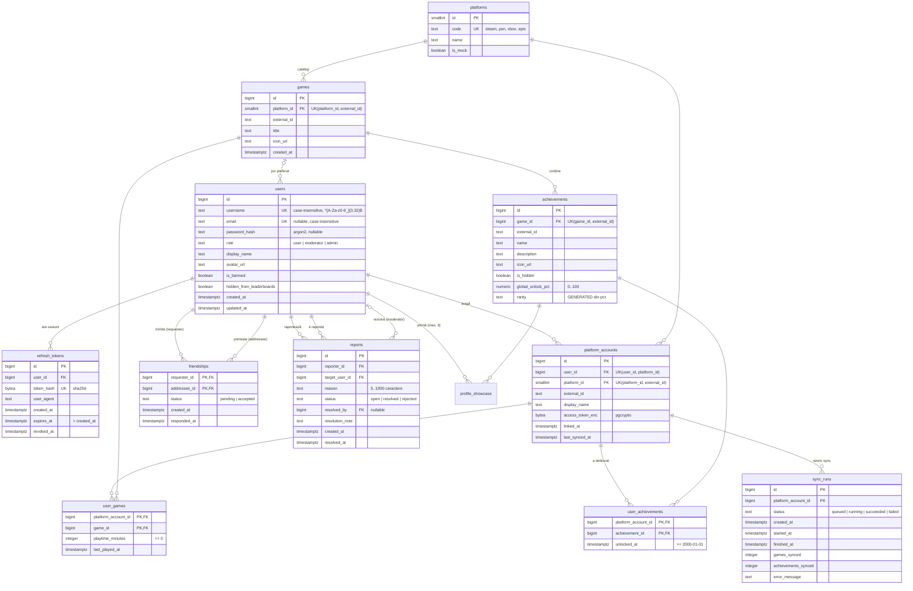

# Modelul de date

PostgreSQL pe Supabase, schema `public`, 12 tabele. Migrațiile sunt în `db/migrations/` (rulate în ordinea numerelor).
Deciziile de design (Dn) sunt explicate în `DECISIONS.md`.

## Diagrama ER

## Tabelele, pe scurt

| Tabel | Ce reprezintă | Constrângeri importante |
|---|---|---|
| `users` | Contul din aplicație + rolul | `role` CHECK în 3 valori; username/email unice case-insensitive (index unic pe `lower(...)`); parola cere email |
| `refresh_tokens` | Sesiunile active (refresh token hash-uit) | `token_hash` UNIQUE; `expires_at > created_at`; CASCADE la ștergerea userului |
| `platforms` | Steam / PSN / Xbox / Epic (date de referință) | `code` UNIQUE + format; RESTRICT la ștergere dacă are conturi sau jocuri |
| `platform_accounts` | Un cont de platformă legat de un user | max. 1 cont per platformă per user; un cont extern legat de max. 1 user |
| `games` | Catalogul de jocuri per platformă | `(platform_id, external_id)` UNIQUE: cheia naturală folosită la sync (upsert) |
| `achievements` | Achievement-urile unui joc + raritatea globală | `(game_id, external_id)` UNIQUE; procent 0–100; `rarity` coloană generată |
| `user_games` | Jocurile deținute de un cont + timp jucat | PK compus; `playtime_minutes >= 0` |
| `user_achievements` | Ce a deblocat fiecare cont și când | PK compus (nu poți debloca de 2 ori); dată ≥ 2000 |
| `sync_runs` | Istoricul sincronizărilor | status CHECK; `failed` ⇒ `error_message` obligatoriu; `finished_at >= started_at` |
| `friendships` | Cereri de prietenie / prieteni | nu cu sine; un singur rând per pereche (index unic pe LEAST/GREATEST) |
| `reports` | Raportări de profil, rezolvate de moderatori | nu te poți raporta; status ↔ `resolved_at` consistente |

## Cum răspunde schema la cerințele domeniului

- **Profil unificat:** toate `platform_accounts` ale unui user → `user_games` / `user_achievements` agregate.
- **Progres pe joc:** `count(user_achievements)` / `count(achievements)` pentru acel `game_id`.
- **Raritate:** `achievements.global_unlock_pct` (de la platformă) → `rarity`.
- **Clasamente:** numărul de achievement-uri (sau scor ponderat cu raritatea) per user, excluzând `hidden_from_leaderboards`;
  global sau doar între prieteni (`friendships` cu `status = 'accepted'`).
- **Roluri:** `user`: propriul profil, conturi, prieteni, raportări; `moderator`: rezolvă raportări, ascunde useri din
  clasamente, editează catalogul de jocuri/achievement-uri; `admin`: tot, plus gestionarea userilor/rolurilor/platformelor
  și rapoartele globale.

## Ce lipsește intenționat

- Indecși de performanță (în afara celor din PK/UNIQUE): vin în etapa 7, cu EXPLAIN ANALYZE înainte/după (D10).
- Tabelul de evidență a migrațiilor (`schema_migrations`): îl creează runner-ul de migrații din etapa 2.
- Tabelele pg-boss: pg-boss își creează singur schema `pgboss` la pornire.

## Personalizarea profilului (migrația 009, D46)

| Coloană / tabel | Tip | Constrângeri |
|---|---|---|
| `users.bio` | text | `char_length(bio) <= 300` |
| `users.accent_color` | text, implicit `violet` | CHECK în (`violet`, `blue`, `cyan`, `emerald`, `amber`, `rose`) |
| `users.banner` | text, implicit `aurora` | CHECK în (`aurora`, `sunset`, `ocean`, `forest`, `midnight`) |
| `users.favorite_game_id` | bigint | FK → `games`, `ON DELETE SET NULL`; API-ul cere ca jocul să fie în biblioteca userului |
| `users.avatar_url` | text | CHECK `^https://` (fără `javascript:` / `http:` în ``) |
| `profile_showcase` | (`user_id`, `position`) PK, `achievement_id` | `position BETWEEN 1 AND 3`, UNIQUE (`user_id`, `achievement_id`), ambele FK cu `ON DELETE CASCADE`; „doar achievement-uri deblocate” verificat în API |
